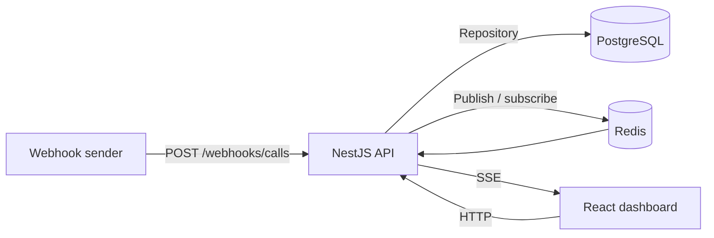

# Realtime Call Manager


Aplicación full stack para recibir y gestionar llamadas entrantes mediante un webhook idempotente.
Incluye un panel React actualizado en tiempo real con SSE y una API organizada con Clean Architecture.

## Arquitectura

```text
realtime-call-manager/
├── apps/
│   ├── api/                 # NestJS: dominio, casos de uso, adaptadores y HTTP/SSE
│   └── web/                 # React + Vite: listado, filtros y acciones de spam
├── packages/
│   └── contracts/           # Tipos y constantes compartidos
├── scripts/
│   └── prepare-test-db.sh   # Preparación de la base de datos de test
├── docker-compose.yml       # PostgreSQL, Redis, migración, API y frontend
└── pnpm-workspace.yaml
```

La API aplica Clean Architecture y mantiene las dependencias apuntando hacia el dominio:

```text
apps/api/src/calls/
├── domain/           # Entidades, reglas, errores y puertos
├── application/      # Casos de uso y flujo de eventos
├── infrastructure/   # Adaptadores Prisma y Redis
└── presentation/     # Controllers, DTOs, guards y filtros HTTP
```

El dominio no depende de NestJS, Prisma ni Redis; la aplicación depende de puertos y la infraestructura los implementa.



## Requisitos

- Docker Engine y Docker Compose
- Node.js 24.14.0 (el entorno local validado; Docker usa la serie 24 con `node:24-slim`) y pnpm 10.33.0 para ejecutar tests fuera de Docker

## Ejecutar

Desde la raíz del repositorio:

```bash
cp .env.example .env
docker compose up --build
```

Compose inicia PostgreSQL y Redis, aplica las migraciones y levanta API y frontend.

- Panel web: http://localhost:5173
- API: http://localhost:3000
- Swagger: http://localhost:3000/docs
- Endpoint del webhook: `POST http://localhost:3000/webhooks/calls`

El secreto del webhook se configura con `WEBHOOK_SECRET` en `.env`; el valor configurado para desarrollo es `RcM_webhook_auth_cb93cb15cf`.

Para enviar un webhook desde Swagger, abre `/docs`, expande `POST /webhooks/calls` y pulsa **Try it out**. En los parámetros de la operación completa `X-Webhook-Secret` con el valor de `WEBHOOK_SECRET`; luego completa el payload y ejecuta la petición. Una llamada nueva responde `201`; si repites el mismo `callId`, responde `200` con `duplicated: true`.

Los puertos `3000`, `5173`, `5432` y `6379` deben estar disponibles en el host. Para detener los servicios conserva los datos con `docker compose down`. Para eliminar también los volúmenes y la base de datos local usa `docker compose down -v` (borra los datos persistidos).

## API

| Método | Ruta | Descripción |
| --- | --- | --- |
| `POST` | `/webhooks/calls` | Registra una llamada; requiere `X-Webhook-Secret`. Responde `201` para una nueva y `200` para un duplicado. |
| `GET` | `/calls` | Listado paginado y filtrable. Acepta `page`, `pageSize` (máximo 100), `search`, `agent`, `isSpam`, `isRepeatCaller`, `from`, `to`, `sortBy` y `order`. |
| `PATCH` | `/calls/:id/spam` | Cambia el estado de spam con un cuerpo como `{ "isSpam": true }`. Repetir el mismo cambio no genera otra actualización. |
| `GET` | `/calls/stream` | Stream SSE con eventos `call.created`, `call.spam_updated` y heartbeat. |

## Probar el flujo

El siguiente ejemplo crea un cuerpo una vez y lo envía dos veces sin cambiar el `callId`. La primera respuesta debe ser `201` (`duplicated: false`) y el retry `200` (`duplicated: true`):

```bash
CALL_ID="demo-$(date +%s)"
BODY=$(printf '{"callId":"%s","phoneNumber":"+573001234567","agent":"agente-07","durationSeconds":90,"recordingUrl":"https://grabaciones.ejemplo.com/b.mp3"}' "$CALL_ID")

curl -i -X POST http://localhost:3000/webhooks/calls \
	-H 'Content-Type: application/json' \
	-H 'X-Webhook-Secret: RcM_webhook_auth_cb93cb15cf' \
	-d "$BODY"

curl -i -X POST http://localhost:3000/webhooks/calls \
	-H 'Content-Type: application/json' \
	-H 'X-Webhook-Secret: RcM_webhook_auth_cb93cb15cf' \
	-d "$BODY"
```

Para ver un caller recurrente, envía otra llamada con un `callId` distinto y el mismo `phoneNumber`; el panel la marcará como recurrente. En el panel, usa la acción de spam de una llamada y comprueba que el cambio se refleja en tiempo real en otra pestaña abierta.

## Tests

En un clon nuevo, instala las dependencias y compila los contratos compartidos antes de ejecutar los tests. La API importa algunas constantes runtime de `@rcm/contracts`, que se generan en `dist/`:

```bash
pnpm install
pnpm build:contracts
```

Los tests de integración y E2E necesitan PostgreSQL y Redis reales. Con `.env` configurado, inicia los servicios de datos y prepara la base aislada de tests:

```bash
docker compose up -d postgres redis
pnpm test:db:prepare
```

Ejecuta las suites desde la raíz:

```bash
pnpm test       # Unit tests
pnpm test:int   # Integración con PostgreSQL y Redis de test
pnpm test:e2e   # Endpoints HTTP, webhook, spam y SSE
```

La configuración usa `DATABASE_URL_TEST` (base cuyo nombre termina en `_test`) y `REDIS_URL_TEST` (base Redis distinta de la base por defecto). Los valores locales están documentados en `.env.example`.

## Decisiones técnicas

- **Capas y dependencias:** dominio y aplicación no dependen de NestJS, Prisma ni Redis; los puertos permiten sustituir adaptadores sin mover las reglas de negocio.
- **Idempotencia y respuestas:** Redis evita trabajo repetido y la restricción única de `call_id` en PostgreSQL es la garantía final. Las llamadas nuevas responden `201`; los duplicados responden `200` con la llamada existente y `duplicated: true`, así el emisor interpreta el retry como exitoso en vez de repetirlo por un `409`.
- **SSE y Redis Pub/Sub:** el flujo es solo servidor→cliente, por eso SSE es más simple que WebSockets; `EventSource` reconecta automáticamente y el heartbeat mantiene viva la conexión. Redis distribuye eventos entre instancias.
- **Degradación de Redis:** si Redis falla al adquirir la clave de idempotencia, la API continúa y PostgreSQL conserva la garantía de unicidad. La publicación Pub/Sub es best-effort: si Redis no está disponible, la llamada queda persistida pero el evento en vivo puede perderse.
- **Prisma detrás de un repositorio:** los casos de uso dependen de `CallRepository`, lo que mantiene el acceso a la base de datos fuera de la lógica de aplicación.
- **pnpm workspaces y contratos:** `@rcm/contracts` comparte tipos y constantes entre API y frontend; la validación runtime se queda en los DTO de la API. El workspace facilita compilar y versionar los paquetes juntos.
- **Datos de test separados:** las pruebas usan una base PostgreSQL `_test` y una base lógica Redis distinta de la predeterminada para no mezclar datos locales.
- **React + Vite:** el panel no requiere SSR ni SEO, así que una SPA mantiene el frontend simple y se sirve como archivos estáticos.

## Alcance y mejoras futuras

Quedaron fuera de este alcance la autenticación de usuarios y roles, el patrón outbox para garantizar publicación durable, la paginación por cursor, el rate limiting y la observabilidad completa (métricas, trazas y alertas). Son mejoras naturales para un despliegue productivo con mayor carga y requisitos operativos.

## Uso de IA

Usé IA en tres fases. La IA propuso alternativas y código; yo elegí, revisé y probé cada pieza.

1. **Definición del plan.** Antes de escribir código, comparé alternativas de stack y arquitectura como NestJS o Laravel, Next.js o React + Vite, SSE o WebSockets, y Redis más constraint único o solo constraint. La IA ayudó a estructurar el plan de commits y a identificar riesgos; el plan fue cambiando durante la implementación.

2. **Implementación y revisión.** Usé IA como copiloto para partes de la API, los adaptadores de Redis y Prisma, los Dockerfiles y componentes del frontend. Revisé las sugerencias y las contrasté con los builds, los tests y Docker Compose.

3. **Verificación.** Ejecuté tests unitarios, de integración y E2E, y comprobé el arranque con Docker Compose para verificar el comportamiento del sistema.
